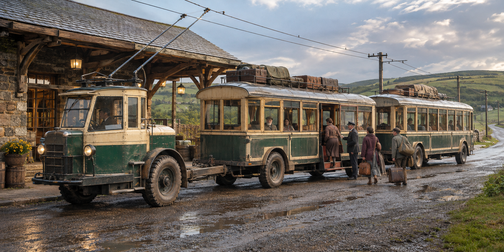
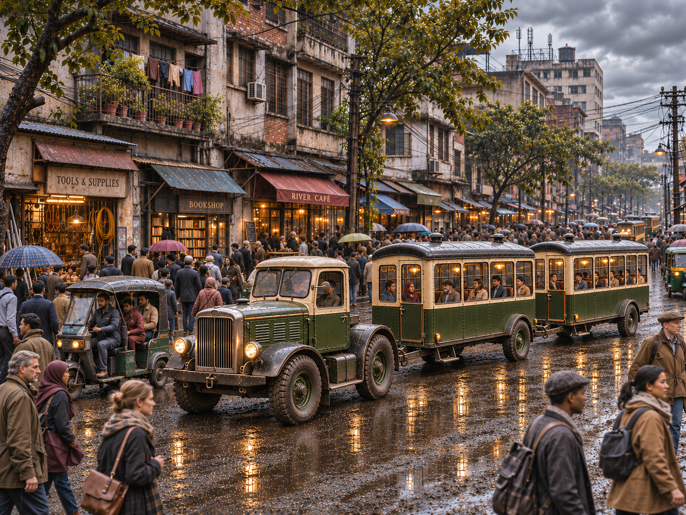
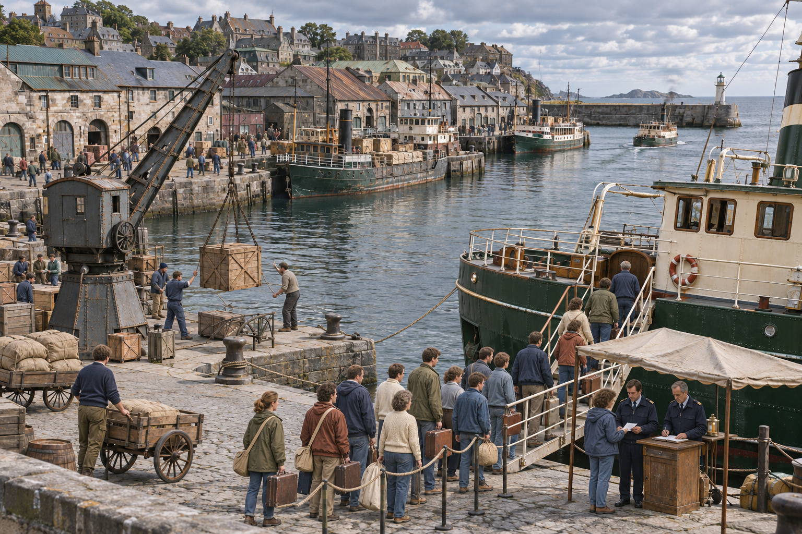
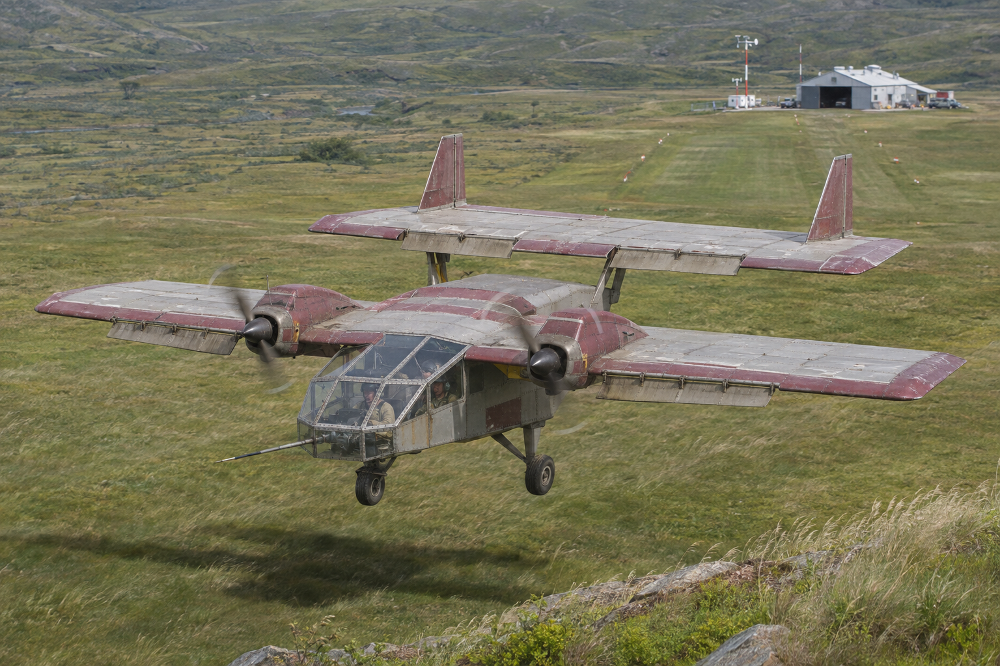

# Transportation in Yanorra

Transportation in Yanorra is dominated by shared overland services, regional railways, and coastal shipping. The relay is the most widespread passenger transport system, linking settlements beyond the reach of rail. Railroads are particularly common in Ronobetu, Barrel and southern Velu. Privately owned diesel vehicles remain relatively uncommon, although ownership is increasing in the wealthy nations of Barrel and Ronobetu.

Long-distance journeys frequently combine several modes of transport. A traveler may take a train between major centers, continue by relay through smaller settlements, and board a ship for the coastal or island stages of a journey. Air travel remains experimental.

## Railroads

Railroads form an important part of the transport networks. The largest networks are found in Ronobetu, Barrel and southern Velu. They carry passengers and freight between major settlements and provide connections to ports and industrial centers.

Rail service is less extensive elsewhere. Thornbelt is constructing a railroad, but the line is not yet fully operational. Existing roads and relay services continue to carry passengers along the corridor.

Railroads and the relay serve complementary roles. Rail concentrates traffic along established routes, while relay carriages provide connections to settlements without stations and carry passengers beyond the ends of completed lines.

## The relay

The relay is Yanorra's most common passenger transport system. It consists of scheduled road services linking towns, cities, and intermediate wayhouses. Its organization preserves features of older caravan travel, including travel in stages, established stopping places, and the exchange of towing units along a route.

### Vehicles and power

<figure style="max-width: 500px; margin: auto; margin-bottom: 15px; margin-top: 15px; text-align: center;">
    
    <figcaption style="font-size: 0.9em;">Passengers board the electric relay at a Thornbelt wayhouse.</figcaption>
</figure>

Passenger carriages are drawn by separate powered vehicles known as haulers. A hauler may tow one or more carriages, depending on the road, gradients, and size of the service. Separating the passenger accommodation from the powered unit allows a carriage to continue its journey after a change of hauler.

On electrified routes, haulers draw power from overhead wires. The vehicles run on road wheels rather than rails, allowing the service to use existing roads. The extent of electrification and arrangements for unwired sections vary by route.

### Wayhouses and operation

<figure style="max-width: 500px; margin: auto; margin-bottom: 15px; margin-top: 15px; text-align: center;">
    
    <figcaption style="font-size: 0.9em;">A diesel-powered relay carrying passengers through the busy streets of Big Bay, Velu.</figcaption>
</figure>

Wayhouses serve as stopping places, interchange points, and maintenance facilities. Depending on their size, they provide meals, lodging, luggage handling, repairs, and replacement haulers. Longer journeys may include overnight stops.

Passengers commonly refer to taking "the relay" and to boarding a particular "carriage." The term "hauler" refers to the powered towing vehicle rather than the passenger accommodation.

The relay remains important even in nations with extensive railroads. Its broad coverage makes it a principal means of reaching smaller settlements and completing journeys that begin by train or ship.

## Personal diesel vehicles

Personal diesel vehicles are becoming more common in Barrel and Ronobetu. Both nations possess the wealth to support increasing private ownership, although shared transport remains important.

Private vehicles allow their owners to travel independently of railway timetables and relay departures. Their usefulness nevertheless depends on road conditions and access to fuel and maintenance. Increasing ownership has not displaced the relay as Yanorra's most widespread passenger system.

## Ships and maritime routes

<figure style="max-width: 500px; margin: auto; margin-bottom: 15px; margin-top: 15px; text-align: center;">
    
    <figcaption style="font-size: 0.9em;">Passengers board a coastal ferry at Gate Thaurin while dockworkers handle cargo along the quay.</figcaption>
</figure>

Ships are a common means of moving passengers and freight between coastal settlements and islands. Maritime travel is constrained by conditions in the open oceans: across much of Yanorra, dependable navigation is limited to routes remaining within a few hundred miles of land.

Consequently, shipping commonly follows coastlines or moves between islands. A sea journey may require a succession of ports rather than a direct crossing. The distance that vessels can safely venture offshore varies by region and conditions; it is not a single universal limit.

These restrictions make coastal ports, island connections, and overland passages important parts of the wider transport network.

## Experimental air travel

<figure style="max-width: 500px; margin: auto; margin-bottom: 15px; margin-top: 15px; text-align: center;">
    
    <figcaption style="font-size: 0.9em;">An experimental tandem-wing aircraft makes a low pass over a test field in Ronobetu during trials to improve control in gusty air.</figcaption>
</figure>

Universities, governments, and other institutions are experimenting with air travel, but aviation has not developed into a dependable passenger transport system. Atmospheric instability above the terrain restricts the height, range, and reliability of experimental flights.

A shifting zone of dangerous wind shear and vertical air currents often begins low above the terrain, well above the rooftops but still within the lower air. Its lower boundary varies with location and atmospheric conditions, and the hazardous air extends substantially higher than the initial boundary.

Under these conditions, individual flights are possible, but predictable long-distance passenger service remains impractical. Institutional research continues into aircraft control, atmospheric measurement, and the identification of temporary flight corridors.

## Regional overview

Yanorra's transport network is organized around distinct regional corridors, with roads, railways, and sea crossings meeting at a limited number of settlements. The mapped routes show the following connections; a drawn railway does not by itself establish that the whole line is open to traffic.

| Region | Transport highlights |
| --- | --- |
| Ronobetu and S’Tsutodo | Rail links Dotap, Cam Tower, and Dima Eta, with a line through Clitham toward Evey Crossing. |
| Thornbelt | Thornbelt Pass carries road and relay traffic between Dotap and Fort 32. Mapped rail ends at West Gate 34. |
| Duvessa and its southern approaches | Port Moa anchors inland roads. Port Sable connects by sea to Sabletown and the islands toward Velu. |
| Velu | Roads connect to Barrel. Gate Thaurin links by sea to Duvessa via Gate Genesis and Gunsey. |
| Barrel | Rail links Seshai and Hawntai. The Seshian Crossing connects Seshai by sea to the Rai rail corridor. |
| Rai–Towboketer corridor | Continuous rail crosses several countries from Rai to Towboketer. The Chatunkut Connector serves the road corridor. |
| Barrel Islands | Roads link Vagu and Toton. The lost Barrel Islands Route carries no traffic. |
| Bibishirif, Totoku, and neighboring southern states | Roads link Zayn al-Qamar, Dudbury, and Totoku. The Three Sisters Connector extends toward Sanceibei. |
| Hav and the outer approaches | The Queen highway links Dima Eta by sea to Alonah-Clif and Flord-Clif. Local trails continue inland. |